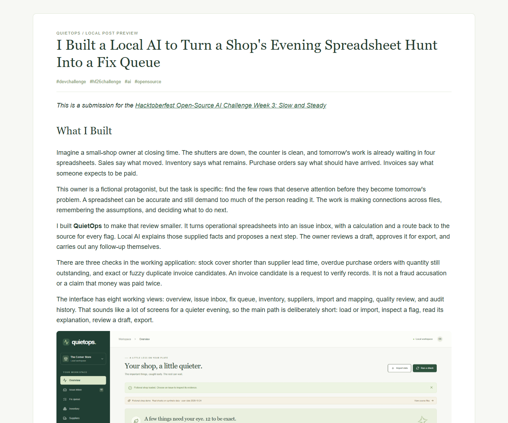

# QuietOps

**A little less on your plate.** Turn a shop’s inventory, sales, deliveries and invoice spreadsheets into a short, evidence-backed review queue.

QuietOps is a working local application: Next.js + TypeScript + Tailwind + shadcn/Radix components, FastAPI, Pandas, DuckDB, SQLite, and **Ministral 3 8B** through Ollama. Deterministic code finds candidates; local AI explains the supplied facts and drafts a review step. A person edits and approves drafts before export. It does not send messages, place orders, or alter financial records.

## Finished local deliverables

- [Narrated demo](demo/assets/video/final_demo.mp4): 118.12 seconds, 1920×1080, genuine Kokoro-82M George (`bm_george`) voice selected by the user, readable burned-in English captions, real browser/backend/model journey on explicitly fictional data.
- [Voiceover WAV](demo/assets/audio/kokoro_voiceover.wav), [SRT captions](demo/assets/audio/subtitles.srt), and [narration script](demo/assets/audio/narration_script.md).
- [Article Markdown](docs/DEV_SUBMISSION.md) and [offline article/video preview](docs/DEV_SUBMISSION.html), with actual screenshots and measured results. [Watch on YouTube](https://youtu.be/NclbnG0_8d0). The user selected GitHub owner **Saifullahakjsnd (Saifullah)**; public visibility is confirmed; authenticated publishing access remains pending.
- [Source and demo bundle](dist/quietops-local-bundle.zip), with checksums in `dist/SHA256SUMS.txt`. Model weights, virtual environments, logs and working shop data are excluded. Rebuild with `python -m scripts.package_release`.
- [Fictional fixtures](demo/fixtures/README.md), including four CSVs, a one-sheet XLSX and separately stored gold labels.

The application remains available at **http://127.0.0.1:3002** while its launchers are running. The user uploaded the YouTube video. No GitHub repository or DEV post has yet been created by this workflow.

[](https://youtu.be/NclbnG0_8d0)

## Screenshots

These screenshots come from the running application using explicitly fictional shop data. The same files illustrate the DEV article.

### Original files and confirmed mappings


### Evidence behind a flag


### Genuine local AI explanation


### Approved draft


### Post preview



Read the [complete article draft](docs/DEV_SUBMISSION.md). The preview is a local rendering; the DEV article has not been published automatically.

## Run on Windows

Requires Node 20.9+, Python 3.12+, Ollama 0.13.1+, and enough memory for the model (quantized download approximately 6 GB; runtime memory exceeds file size). The tested machine has 64 GB RAM and an RTX 4090. Other active sessions can keep using their own ports.

```powershell
npm ci
python -m venv .venv
.venv\Scripts\python.exe -m pip install -r backend\requirements.txt
npm run build
```

If uv is installed, the equivalent dependency install is `uv pip install --python .venv\Scripts\python.exe -r backend\requirements.txt`.

Start the dedicated Ollama server in one terminal:

```powershell
powershell -NoProfile -File scripts/ollama.ps1
```

In another terminal, pull the model into the normal Ollama model store. This adds a model; it does not change global settings or unload another session’s model.

```powershell
$env:OLLAMA_HOST = '127.0.0.1:11436'
ollama pull ministral-3:8b
```

Start the application services:

```powershell
powershell -NoProfile -File scripts/start.ps1
```

Open **http://127.0.0.1:3002**. Backend docs: http://127.0.0.1:9002/docs. Logs live in `logs/`. Startup skips occupied ports and never terminates existing processes; inspect their owners if a service is not QuietOps. For development, use `npm run dev` instead of the frontend launcher.

`powershell -NoProfile -File scripts/stop-app.ps1` stops only frontend/backend listeners whose process ancestry is verified against this workspace path. It leaves other ports and the Ollama server alone.

For manual startup:

```powershell
# Terminal 1, Ollama already running on 11436
powershell -NoProfile -File scripts/backend.ps1
# Terminal 2
npm run dev
```

Linux/macOS: set `OLLAMA_HOST=127.0.0.1:11436 ollama serve`, then pull the model with the same host, run `python -m uvicorn backend.main:app --host 127.0.0.1 --port 9002`, and `npm run dev`. Use the equivalent virtual-environment activation for your platform.

## Try the complete journey

1. Select **Explore a demo shop** in an empty workspace. All demo data is explicitly fictional. The fixed scan date is 2026-10-24.
2. Open an issue and inspect its source files, cells, sales aggregate row membership, calculation and assumptions.
3. Select **Explain with local AI**. This calls the real local model; there are no substitute responses when it is unavailable.
4. Create an action draft, review/edit the wording, approve for export, and download the Markdown drafts.
5. Inspect inventory, suppliers and the audit trail. Download original files from Import & mapping.

The demo has 60 SKUs, 12 suppliers, 5,400 sale rows, 24 purchase order lines, and 38 invoice rows. The gold labels are generated separately from detector input: six stockout risks, four overdue orders, one exact duplicate candidate and one fuzzy candidate. Evaluation is a controlled synthetic fixture, not a claim about accuracy in real shops.

## Import your data

Use a fresh data directory for your own shop. Set `QUIETOPS_DATA` to an absolute directory in the backend terminal before starting it. The application is a single-owner, single-snapshot workspace; an existing inventory or order snapshot cannot silently be combined with another. Demo loading is disabled after a workspace has files.

- UTF-8 CSV or XLSX; a single sheet per workbook. One header row; no merged headings. Maximum 15 MB, 50,000 rows, 80 columns; expanded XLSX ≤100 MB.
- Upload, confirm the dataset type, map every field to a distinct column, and choose the date convention and currency. Mapping suggestions are deterministic header aliases and require confirmation.
- Inventory: `sku,item,supplier,on_hand,lead_days,unit,unit_cost,currency`
- Sales: `sku,date,qty,unit`
- Orders: `order_id,sku,supplier,expected_date,ordered_qty,received_qty,unit`
- Invoices/expense invoice sheets: `invoice_id,supplier,date,amount,currency`

Use explicit unit labels such as `each` consistently across inventory and sales. No currency or unit conversion is assumed. Required blanks, invalid/ambiguous dates, non-finite/negative numbers, values above one trillion, monetary values finer than two decimals, nonpositive lead times, mixed currencies within a file, overreceived orders and repeated snapshot identifiers are quarantined. Credits/returns need a separate accounting flow. Invoice duplicate identifiers are intentionally retained as review candidates. Missing/incompatible sales and sparse observations appear in Inventory as weak estimates. Correction proposals are a separate CSV and do not change scans or originals.

## Checks and evidence

- **Stock cover:** on hand / (sales quantity / calendar days from first observed sale through scan date), up to 90 trailing days. Risk when cover < supplier lead time. Missing dates count as zero; fewer than 14 observed dates is sparse. Incoming orders are not netted off. Confirm inventory freshness.
- **Delivery:** expected date < scan date and cumulative received < ordered. Assumes the file is an up-to-date snapshot.
- **Exact invoice candidate:** normalized supplier + invoice ID match. It is not a statement about payments or fraud.
- **Fuzzy invoice candidate:** same supplier/currency/amount, date distance ≤3 days, invoice ID similarity ≥0.70. These can be legitimate transactions. Buckets >200 equal-amount invoices are rejected for manual splitting rather than doing unbounded pairwise work.

Source file hashes and unmodified bytes are retained. Every evidence item links to the original and maps fields to cells. Aggregated sales list all contributing source rows, sum, date range and units. The AI receives only issue facts and compact source references, with a constrained JSON schema. Source-ID validation, numeric-token checks and a conservative phrase guard reject some unsupported content. These guards **do not prove semantic correctness**; humans must review output. Changed evidence invalidates AI text and action exports.

## Verification

```powershell
.venv\Scripts\python.exe -m pytest backend/tests -q
.venv\Scripts\python.exe -m backend.eval.run_evaluation --real-ai
npm run typecheck
npm run build
npm run test:e2e
```

Browser tests expect the application and real model to be running. Run them against a backend started with a separate `QUIETOPS_DATA` directory; they add fictional rows. Playwright uses installed Microsoft Edge; change `channel` in `playwright.config.ts` for another installed browser. The demo recorder uses Edge too. It records actual UI and inference, never a fabricated video. See [docs/EVALUATION.md](docs/EVALUATION.md) for measured results and limitations.

For isolated browser tests, start `scripts/backend-e2e.ps1` instead of `scripts/backend.ps1`; it makes a timestamped test data directory. For recording, use `scripts/backend-record.ps1`, then `npm run demo:record`. Stop the previous QuietOps backend before switching. Optional Kokoro narration tooling is in `demo/prepare_narration.py` and `demo/requirements-narration.txt`; inspect real voices and generate labelled previews with `--preview`. Final narration requires an explicit `--voice` selected by the user.

The completed narration uses `python demo/finish_video.py --voice bm_george`. It requires the optional narration dependencies and genuine Kokoro assets prepared by `demo/prepare_narration.py`. `narration-scenes.json` is bound to the current silent-video hash: after rerecording, inspect scene changes and retime that plan before rerendering. It preserves actual screen timing and adjusts speech modestly to fit the observed scenes. `demo/verify_playback.ts` verifies the final MP4 and offline article in Edge. Optional independent CPU transcription and the article renderer use `demo/requirements-qa.txt`; `demo/verify_narration.py` records an ASR check without claiming perfect recognition or human listening review.

## Local deployment and privacy

`docker compose up --build` runs the frontend/backend against a host Ollama server. For Docker only, expose a dedicated host Ollama listener to Docker’s host gateway and set `OLLAMA_URL`; avoid exposing it to untrusted networks. The native loopback scripts are the simplest private option. Docker configuration is provided separately from verified native execution.

SQLite, uploaded originals and derived records live in `data/` by default and are excluded from Git along with `.env`, dependencies and logs. They are local and **unencrypted**. No authentication or multi-user authorization is implemented: bind to loopback and use a trusted machine. No analytics, remote inference, automatic email or background scan jobs. Downloading the model/dependencies requires internet; analysis and inference then run locally.

## Model and licenses

Application: MIT. Model: [Ministral 3 8B Instruct 2512](https://huggingface.co/mistralai/Ministral-3-8B-Instruct-2512), Apache 2.0; [Ollama build](https://ollama.com/library/ministral-3). The model digest and runtime are recorded in evaluation output after genuine inference. Uses a 4096-token context, deterministic sampling, one concurrent request, five-minute keep-alive. There is no Gemma integration or eligibility claim for its category. No TabPFN integration is claimed.

Architecture: [docs/ARCHITECTURE.md](docs/ARCHITECTURE.md). Recording walkthrough: [docs/DEMO_SCRIPT.md](docs/DEMO_SCRIPT.md). Publication remains subject to the account, voice and video handoffs in [docs/PUBLISHING_CHECKLIST.md](docs/PUBLISHING_CHECKLIST.md).
