# Architecture

```mermaid
flowchart LR
  User[Shop owner] --> UI[Next.js UI :3002]
  UI --> API[FastAPI :9002]
  API --> Parser[Pandas CSV / openpyxl XLSX]
  Parser --> Mapping[Explicit mapping and validation]
  Mapping --> Originals[Immutable original bytes + SHA-256]
  Mapping --> SQLite[(SQLite local records)]
  SQLite --> Rules[DuckDB aggregation + deterministic detectors]
  Rules --> Evidence[Issues + exact source cells and rows]
  Evidence --> LLM[Dedicated Ollama :11436 / Ministral 3 8B]
  LLM --> Guards[JSON schema / source IDs / numeric guard]
  Guards --> Review[Editable action draft]
  Review --> Decision[Human approval / rejection]
  Decision --> Export[Manual follow-up export]
```

## Data and boundaries

`Dataset` stores the original file hash, sheet, headers, preview and confirmed mapping. Raw string values remain separate from validated rows. Canonical InventorySnapshot, Sale, PurchaseOrder and Invoice rows retain `_source` metadata for every mapped field. `DataQualityIssue` rows are quarantined and excluded from computations. `DetectedIssue` contains typed `Evidence`, facts, assumptions and a stable entity ID. `ActionProposal`, `Decision`, correction proposals and `AuditEvent` are separate records. Pydantic request schemas validate HTTP inputs; detector/model tests exercise the data contracts.

SQLite uses a generic bucket/key/JSON table to keep the prototype inspectable without ORM migrations. SQLite WAL and a process-local mutation lock serialize mutations in the intended single-worker deployment. Do not run multiple application workers against one data directory; background jobs and distributed synchronization are outside scope. Source imports and derived state use separate records; recovery can rerun scans from retained valid data.

DuckDB operates on the validated sales DataFrame through an in-memory connection. Query text is fixed; user strings are never inserted into SQL. Invoice fuzzy comparisons are bucketed and bounded. File size, row count, column count, and expanded workbook size have explicit limits.

## AI trust boundary

Local inference is required for the explanation/proposal path. Deterministic issues still work without a model, with unavailable/validation errors visible. The model never receives tools to mutate files or contact services. It sees compact computed facts and source references rather than the entire sales sheet. Input strings are explicitly treated as untrusted. JSON output must match the schema and reference existing evidence IDs; numeric tokens outside supplied issue data and selected unsafe assertions cause withholding. This reduces some hallucinations but cannot establish semantic truth.

Evidence/facts/assumptions/calculation are fingerprinted. Rescanning changed data drops AI output and marks action drafts stale. Approved stale actions are excluded from export. Approval decisions are immutable; no duplicate outgoing side effects exist because export is the only action. An audit event is written for imports, scans, AI success/failure, proposal, approval and export.

## Local operation

Separate ports, virtual environment, data directory and child-process environment avoid changing concurrent projects. Ollama model files use the machine’s configured model store; adding a tag does not remove existing models. Native launchers bind to loopback. Logs and data are ignored by Git. Docker is an optional configuration, with host Ollama addressing requiring explicit local network setup.

## Current limits

Single owner, single inventory/order snapshot per workspace; additive sales/invoice imports must not overlap. No automatic currency/unit conversion, returns accounting, physical arrival tracking, forecast models, anomaly scanning or recurring jobs. One sheet per workbook. Stock cover assumes zero demand on missing dates and current inventory. Local records are unencrypted and the API has no authentication. The synthetic evaluation does not measure real-world precision or owner time saved.
