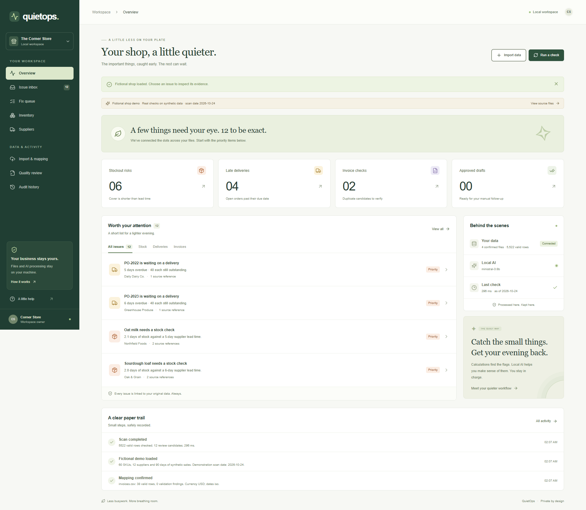
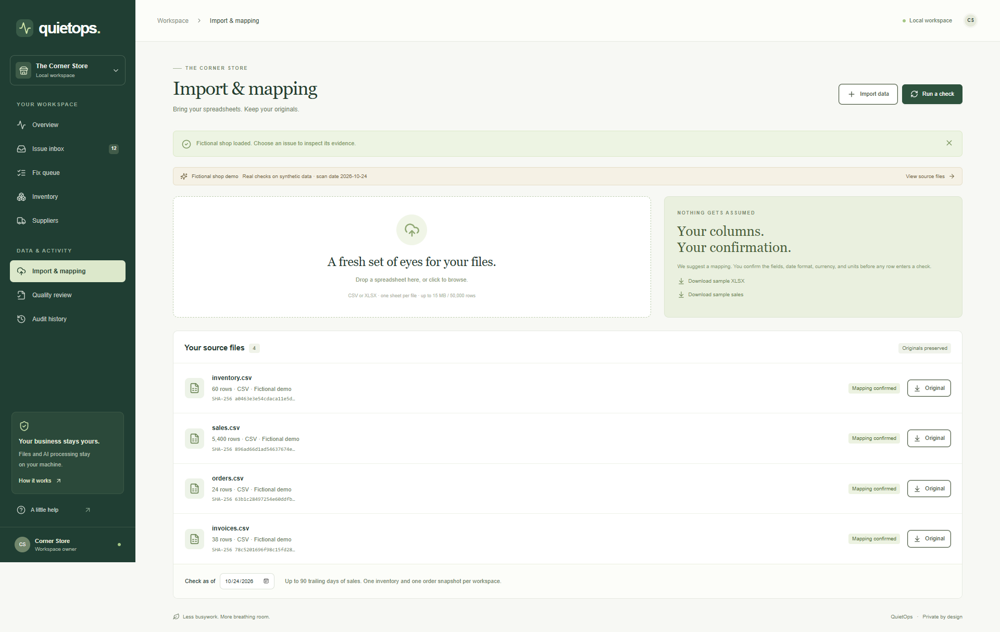
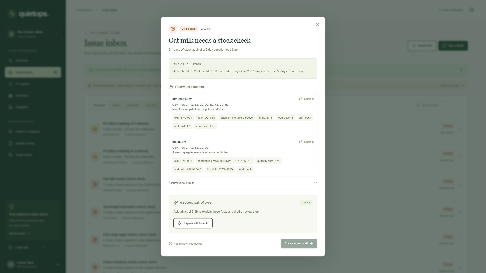
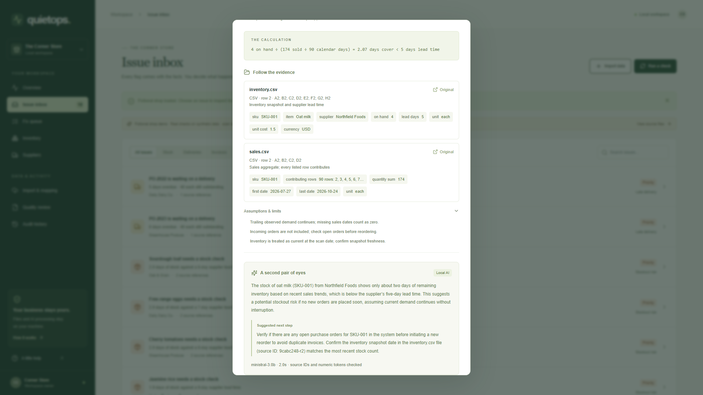
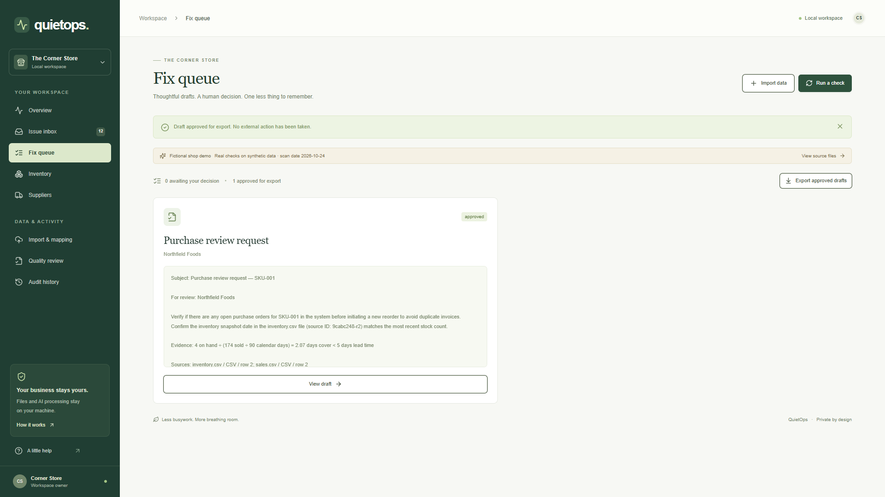

<!-- REVIEW DRAFT. The supplied YouTube URL is verified and embedded. The user selected GitHub owner Saifullahakjsnd (Saifullah); repository public visibility is confirmed; authenticated publishing access is still pending. Screenshot links remain actual local files until public hosting is verified. Do not publish unchanged local image/source-archive links. -->

Title: I Built a Local AI to Turn a Shop's Evening Spreadsheet Hunt Into a Fix Queue

Tags: devchallenge, hf26challenge, ai, opensource

*This is a submission for the [Hacktoberfest Open-Source AI Challenge Week 3: Slow and Steady](https://dev.to/challenges/hacktoberfest-week3-2026-10-19)*

## What I Built

Imagine a small-shop owner at closing time. The shutters are down, the counter is clean, and tomorrow's work is already waiting in four spreadsheets. Sales say what moved. Inventory says what remains. Purchase orders say what should have arrived. Invoices say what someone expects to be paid.

This owner is a fictional protagonist, but the task is specific: find the few rows that deserve attention before they become tomorrow's problem. A spreadsheet can be accurate and still demand too much of the person reading it. The work is making connections across files, remembering the assumptions, and deciding what to do next.

I built **QuietOps** to make that review smaller. It turns operational spreadsheets into an issue inbox, with a calculation and a route back to the source for every flag. Local AI explains those supplied facts and proposes a next step. The owner reviews a draft, approves it for export, and carries out any follow-up themselves.

There are three checks in the working application: stock cover shorter than supplier lead time, overdue purchase orders with quantity still outstanding, and exact or fuzzy duplicate invoice candidates. An invoice candidate is a request to verify records. It is not a fraud accusation or a claim that money was paid twice.

The interface has eight working views: overview, issue inbox, fix queue, inventory, suppliers, import and mapping, quality review, and audit history. That sounds like a lot of screens for a quieter evening, so the main path is deliberately short: load or import, inspect a flag, read its explanation, review a draft, export.

The visual tone matters to that workflow. A shop owner should be able to distinguish a priority from a weak estimate without feeling surrounded by alarms. Stock, delivery, and invoice candidates have separate labels; assumptions remain attached to the issue; the model's availability is visible.

## Demo



The [narrated walkthrough](../demo/assets/video/final_demo.mp4) is a real 1920×1080 browser recording, about two minutes long. It uses a running backend and genuine local inference. Its narration was synthesized locally with Kokoro-82M using the user-selected British voice George, `bm_george`. It includes burned-in English captions and a separate [SRT file](../demo/assets/audio/subtitles.srt).

Every shop record in the demonstration is synthetic. The fixture has 60 products, 12 suppliers, 90 days of sales, 24 purchase-order lines, and 38 invoice rows. The recording begins with an empty workspace and selects that fictional shop. It then follows an oat-milk flag through its source evidence, real model explanation, purchase-review draft, approval, export, and audit trail.

The originals remain downloadable throughout. A separate browser test exercises manual CSV upload, explicit mapping confirmation, an invalid row, and a proposed correction. The video uses demo selection so the main review story stays readable.

The [public walkthrough on YouTube](https://youtu.be/NclbnG0_8d0) is available above. The file and screenshot links are retained for local review until the screenshots are hosted. GitHub publication is being prepared under the user-selected account, Saifullahakjsnd; no repository link is claimed before the repository actually exists.

## Code

The [local source-and-demo archive](../dist/quietops-local-bundle.zip) contains the application, setup instructions, tests, synthetic fixtures, evaluation records, screenshots, and finished video. Model weights and private working data are excluded. The application code uses the MIT license; the model licenses are documented separately.

The frontend is Next.js, TypeScript, Tailwind, and Radix-based shadcn components. The backend is FastAPI with Pandas, openpyxl, DuckDB, and SQLite. The explanation model is **Ministral 3 8B**, served through Ollama. There is no paid inference API in the application's review path.

For a fresh Windows checkout, setup is `npm ci`, a project-local Python virtual environment, installation of `backend/requirements.txt`, and `npm run build`. The README gives the complete commands, including the model download. `scripts/start.ps1` starts the local services after setup.

QuietOps uses frontend port 3002, backend port 9002, and a dedicated Ollama listener on 11436. Another project was running on the same machine during development. The launchers use project-specific child environments, leave occupied ports alone, and verify process ancestry before stopping this application's listeners.

## How I Built It

The first decision was to keep arithmetic inspectable. The model does not choose whether a purchase order is late or calculate days of cover. Those checks run deterministically over validated rows. That gives the generated explanation something concrete to explain and the reviewer something independent to challenge.

An imported file first becomes raw strings and an unmodified stored original with a SHA-256 hash. Header aliases suggest a dataset type and column mapping. A person must confirm the fields, date convention, currency, and unit consistency before the rows can enter a scan.

This confirmation is useful friction. A quantity column might mean eaches in one file and cases in another. A date can be ambiguous. A negative invoice might be a legitimate credit, but treating it as a normal bill would silently change what duplicate detection means. QuietOps does not guess a conversion or repair the accounting interpretation.

Required blanks, invalid dates, non-finite or negative numbers, unsupported monetary precision, and inconsistent currencies within a file are quarantined. The importer also catches repeated snapshot identifiers and received quantities greater than ordered quantities. Proposed corrections are separate records and export as a separate CSV. They do not overwrite the original or quietly change a scan.

For stock cover, DuckDB aggregates up to 90 trailing days of validated sales. Daily demand is total observed quantity divided by calendar days from the first observed sale through the scan date. Cover is on-hand quantity divided by that daily demand. A flag appears when cover is shorter than supplier lead time.

In the recorded oat-milk example, four units remain and 174 units sold over 90 calendar days. That gives about 2.07 days of cover against a five-day supplier lead time. The evidence includes the inventory cells, sales total, date range, units, and membership of every contributing source row.

The calculation is useful only with its assumptions. Missing sales dates count as zero demand. Fewer than fourteen observed sales dates is marked sparse. Incoming orders are not subtracted from risk. Inventory is treated as current at the selected scan date, so the owner still needs to confirm snapshot freshness. Incompatible sales units suppress the cover calculation rather than producing a confident-looking number.

The delivery check compares expected date with scan date and cumulative received quantity with ordered quantity. Invoice checks distinguish normalized supplier-plus-ID matches from fuzzy candidates requiring equal supplier, currency and amount, nearby dates, and a similar identifier. Those rules are intentionally legible. They can generate false positives in real workflows, so the output remains a review queue.

Only after a deterministic issue exists does the model receive compact facts, assumptions, and source references. It returns an explanation, a suggested review step, and evidence IDs under a JSON schema. The model has no tools for contacting a supplier, changing a stock record, or issuing a payment.

A real repeat evaluation exposed a useful failure: the model supplied an unknown evidence ID. The post-generation check withheld that response. I retained the rejection in the evaluation records and tightened constrained decoding so the evidence-ID field can select only sources supplied for the issue. A separate numeric-token check rejects numbers outside the available issue data.

Those checks are limited. They validate references and numeric tokens, not the meaning of an entire sentence. One genuine stock explanation said “duplicate invoices” where “duplicate orders” would have been more appropriate. The evaluation documents that imperfection. Editing and human judgement remain part of the product because a schema cannot make prose infallible.

The approval boundary is also enforced in the backend. A proposal requires a successful local explanation. Its text can be reviewed before approval, and only approved, current drafts can be exported. A fingerprint covers facts, evidence, assumptions, and calculations. If a later scan changes that basis, old generated text is dropped and related drafts become stale.

For verification, nine backend tests check arithmetic, source lineage, Excel import, quarantine, unit mismatches, sparse observations, unsupported source IDs and numbers, and stale approvals. Three browser tests cover the real model-to-export journey, mapping and corrections, and mobile navigation. TypeScript checking and a production build also passed. Docker Compose configuration is supplied and validated, but containers were not run because Docker's engine was unavailable; native execution is the verified path.

## Why Does Open Innovation Matter?

Keeping files on the same machine as inference is a practical architectural choice for this task. The owner does not need to send the sales ledger to a paid external inference service just to ask what a flagged row means. Downloads require a connection during setup; the operational review can then run locally.

[Ministral 3 8B](https://huggingface.co/mistralai/Ministral-3-8B-Instruct-2512) has Apache-licensed weights. The local service boundary makes model substitution possible without rewriting the detector or replacing the original evidence. That does not make every alternative equivalent: a replacement still needs the same structured-output checks and task-specific evaluation.

Open components also made the demo reproducible. Playwright records the actual application. FFmpeg handles timing, captions, and encoding. [Kokoro-82M](https://huggingface.co/hexgrad/Kokoro-82M) supplies genuine local speech. The scripts and model hashes are retained, so the finished video has a traceable production process as well as a visible UI.

There are costs and limits. The tested machine had 64 GB RAM and an RTX 4090; I have not established performance on an ordinary shop laptop. Local files are unencrypted, and the API is intended for a trusted, single-owner loopback deployment. There are no recurring scans, returns-accounting workflow, forecast model, or automatic currency conversion. These limits are in the README rather than hidden behind the word “local.”

## The Lazy Payoff

On the controlled synthetic fixture, 5,522 valid rows produced twelve candidates: six stock-cover risks, four late orders, one exact invoice group, and one fuzzy invoice pair. Every injected target was found, with no extra flags in that fixture. Precision and recall were 1.00 for each detector kind. That result describes an in-distribution demonstration, not accuracy in real shops.

The recorded evaluation measured 72 milliseconds for the deterministic scan and 342 milliseconds for fixture generation, import, mapping, and scan together. Four real model calls took approximately 1.36 to 1.92 seconds each on a warm runtime. They are single-example measurements on the tested machine, not latency guarantees.

The video ends with one approved draft. That is the reproducible payoff I can show today: thousands of rows become a short, source-linked queue and a concrete next step. I have not measured a shop owner's saved minutes, so I am not assigning a dramatic number to their evening. A future field study should compare timed manual review with assisted review on held-out data, with owners adjudicating the flags.

The aim is modest enough to be useful: fewer rows to hunt through, fewer assumptions to remember, and a request that is already written when the owner decides to act. Close the shop. Check the evidence. Keep a little of the evening for yourself.

## Prize Categories

This build addresses the overall open-source AI theme. No partner-specific category is claimed. The implemented stack and local narration do not establish a Gemma, TabPFN, or ElevenLabs integration.
