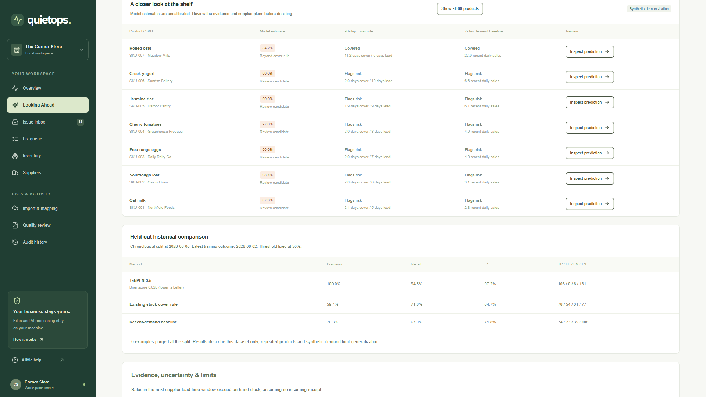
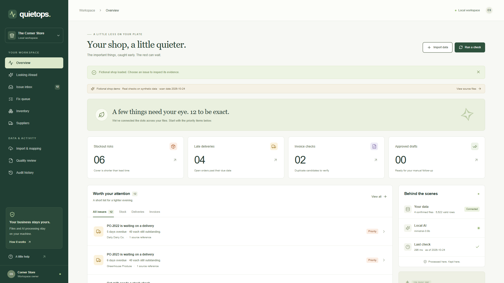
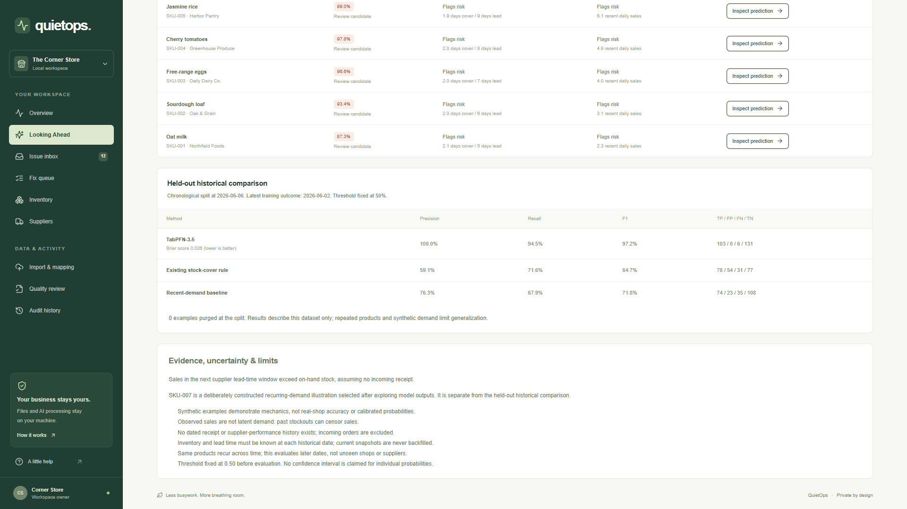
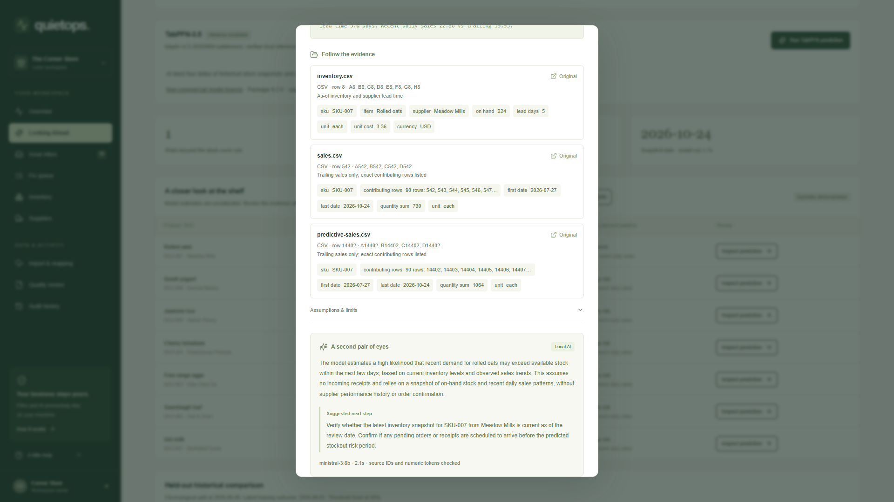
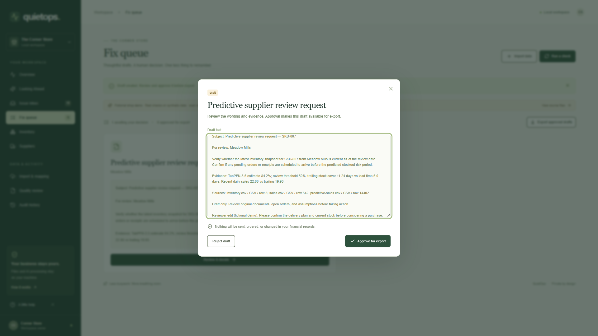

<!-- REVIEW SOURCE: the existing live DEV post is unchanged. Updated code and screenshots are pushed and verified at 0fae4c95149991c28abf4c66c727880dd6c9db8d. The new narrated video awaits the user-supplied YouTube URL. DEV_SUBMISSION_REVIEW.md contains verified hosted screenshots; resolve the video notice before publishing. -->

Title: QuietOps: Local AI, Predictive Stock Risk, and a Quieter Evening

Tags: devchallenge, hf26challenge, ai, opensource

*This is a submission for the [Hacktoberfest Open-Source AI Challenge Week 3: Slow and Steady](https://dev.to/challenges/hacktoberfest-week3-2026-10-19)*

## What I Built

The shop is closed. The spreadsheets are still open.

Imagine an owner trying to finish the day. Sales say what moved, inventory says what remains, purchase orders say what should arrive, and invoices say what someone expects to be paid. Finding one suspicious number is manageable. Connecting four files, checking the assumptions, and deciding what to ask a supplier takes the evening with it.

That owner is a fictional protagonist, not a customer whose saved time I have measured. The task is concrete, though: find the few records worth reviewing and make the next step easier to judge.

I built **QuietOps**, a local operations review agent with an evidence-backed fix queue. It imports CSV or XLSX files, asks the owner to confirm their mappings, quarantines invalid rows, and checks stock cover, overdue deliveries, and duplicate invoice candidates. Local Ministral explains the supplied findings and drafts a review request. The person edits the wording and approves it for manual export.

The new **Looking Ahead** view adds a different question: could sales during a supplier's lead-time window exceed the stock available today? Genuine local **TabPFN-3.5** inference supplies that estimate. It can flag a case that the existing stock-cover rule leaves covered, while keeping the predictive estimate separate from the deterministic finding.

That separation matters. A late order is a calculation from dates and outstanding quantity. A future demand risk is an uncertain model estimate. Putting both in the same red counter would make the interface simpler at the cost of hiding what the owner is being asked to trust.

## Demo

**Updated narrated walkthrough:** the finished local video is [final_demo.mp4](../demo/assets/tabpfn/final/video/final_demo.mp4). Its new YouTube upload and verified embed are pending; this review notice must be replaced before publishing this edition.

The new 143.76-second, 1920?1080 recording follows the actual application, backend, TabPFN inference, local Ministral explanation, editable supplier-review draft, approval, and export. The narration uses genuine local Kokoro-82M with George (`bm_george`), the voice selected for the original demonstration. Captions occupy a strip below the application so they do not cover its controls.

All shop data is explicitly fictional. The original fixture contains 60 products, 12 suppliers, 90 days of sales, 24 purchase-order lines, and 38 invoice rows. Its twelve deterministic review candidates remain reproducible. The predictive companion is optional and separately labelled; it adds earlier synthetic sales and dated stock snapshots without replacing the original files.

The new demo's rolled-oats example has 224 units, about 11.24 days of trailing cover, and a five-day supplier lead time. Its recent seven-day cover also exceeds lead time. Both simple baselines show cover; TabPFN estimates **84.2%** risk that lead-window sales exceed stock, assuming no incoming receipt.

**This current illustration was selected after exploring model outputs.** An initial isolated one-week surge was not flagged, nor were several longer isolated plateaus. The final illustration continues the companion's recurring demand pattern. It demonstrates a possible disagreement, not independently validated predictive performance. The separate held-out historical examples and their reported metrics were not changed during that exploration.

## Code



The [QuietOps repository](https://github.com/Saifullahakjsnd/QuietOps) contains the application, fixture generators, tests, evaluation records, screenshots, and reproducible demo scripts. The updated implementation and demonstration assets are published in the linked repository.

The existing stack remains Next.js, TypeScript, Tailwind, Radix/shadcn components, FastAPI, Pandas, openpyxl, DuckDB, and SQLite. Ministral 3 8B runs through a dedicated local Ollama listener. TabPFN is an optional backend dependency: the original deterministic application remains usable without installing its model runtime.

The new [setup guide](TABPFN_SETUP.md) covers model access, licensing, installation, the historical input contract, and CPU or CUDA configuration. A separate evaluation workspace preserves the normal shop's records. Model weights, credentials, and private working data are excluded from version control.

## How I Built It

I kept three jobs separate: deterministic code calculates present findings, TabPFN estimates a future outcome, and Ministral explains supplied facts. The language model does not invent the probability or decide whether a bill has been paid twice.

**First, make the inputs inspectable.** Every import retains its original bytes and SHA-256. Header aliases suggest a column mapping, but a person confirms fields, date convention, currency, and units. Invalid dates, required blanks, negative or non-finite quantities, incompatible accounting precision, and invalid snapshot identifiers are quarantined. Proposed corrections are separate records, not silent edits to the original.

For the existing stock-cover check, validated sales are aggregated over up to 90 trailing calendar days. Cover is on-hand quantity divided by observed daily sales. A flag appears when that cover is shorter than supplier lead time. Missing feature-window sale dates count as zero, units must be compatible, and incoming orders are not silently treated as guaranteed receipts.

**Next, audit what history actually exists.** Ninety days of sales plus one current inventory snapshot is not a historical stockout dataset. Reusing today's stock or cumulative received quantity at past dates would create information that was not known then.

I added a `stock_history` import type containing SKU, snapshot date, on-hand quantity, supplier, lead days, and unit. The fictional companion provides dated examples. In a real deployment, those values must genuinely have been known at the snapshot date. The current order table lacks receipt-event and historical availability timestamps, so supplier-performance flags and incoming receipt adjustments are excluded from training.

The target is deliberately narrow: **observed sales after the snapshot and through its supplier lead-time window exceed stock on hand, assuming no incoming receipt**. It is a counterfactual demand-exceeds-stock label, not a verified physical stockout. Historical stockouts can censor sales, and actual replenishment can change the outcome.

Features use only sales available at each snapshot: trailing daily rate, seven- and 28-day rates, recent-to-28-day ratio, volatility, stock, lead time, and cover estimates. Product IDs, supplier names, future sales, and fixture gold labels are excluded from the feature matrix. Later sales are accessed separately to label mature outcomes; each outcome-window date needs compatible observations, including explicit zero-sale rows.

**Then evaluate later dates.** The split uses 420 earlier training examples and 240 later test examples. The latest training outcome ends June 2; held-out snapshots begin June 6. Training examples whose outcome windows cross the cutoff are excluded. This fixture's spaced dates required zero exclusions, while regression tests exercise an overlapping boundary.

The adapter pins `tabpfn==9.2.0`, explicitly selects `ModelVersion.V3_5`, and verifies the official checkpoint's SHA-256. It records the revision, package and PyTorch versions, device, seed, ensemble size, and actual inference duration. Disabled, missing, unaccepted, or failed model states remain visible. Another predictor never supplies a TabPFN-labelled score.

All methods receive the same later test examples, with the model's review threshold fixed at 0.50:

| Method | Precision | Recall | F1 | TP / FP / FN / TN |
| --- | ---: | ---: | ---: | --- |
| TabPFN-3.5 | 100.0% | 94.5% | 97.2% | 103 / 0 / 6 / 131 |
| Existing stock-cover rule | 59.1% | 71.6% | 64.7% | 78 / 54 / 31 / 77 |
| Seven-day demand baseline | 76.3% | 67.9% | 71.8% | 74 / 23 / 35 / 108 |

TabPFN's Brier score was 0.0264, ROC AUC 0.9900, and average precision 0.9907. It caught 30 positive held-out examples that the stock-cover rule missed. These are actual outputs from one synthetic temporal holdout. Repeated products and related demand patterns limit independence; neither calibrated business risk nor real-shop accuracy has been established.

The fixture hashes, split boundaries, individual held-out scores, and confusion counts are retained in the evaluation JSON. I did not turn a deliberately favourable live illustration into an extra test result.

**Finally, keep the decision reviewable.** Each prediction links back to the stock snapshot and exact contributing sales rows. Ministral receives the model estimate, facts, assumptions, and evidence IDs, then returns a structured explanation and review step.

Source-ID and numeric-token checks reject unsupported references and numbers. Additional predictive checks reject altered percentages and certainty language. One recording attempt produced wording the uncertainty guard rejected; the app withheld that explanation and blocked the draft. I tightened the prompt's wording instead of weakening the guard. These checks are still conservative lexical checks, not a proof that prose is semantically correct.

The existing Fix queue lets the owner edit, reject, or approve the request. Evidence and model configuration enter its fingerprint. Changed mappings or scan dates make predictive drafts stale; explanation, approval, and export endpoints recheck that boundary. Approval permits a manual export. Nothing is emailed, ordered, or paid automatically.

Verification includes 18 backend tests, three existing browser tests, a separate real-model recording, TypeScript checking, and a production build. Tests cover source lineage, imports, quarantine, chronological leakage, model failure, and stale approvals. Explicit test doubles exercise workflow code; only genuine inference supplies the saved model results and demonstration.

## Why Does Open Innovation Matter?

Keeping shop files and inference on the same machine gives the owner a useful boundary: the sales ledger does not need to be uploaded to a hosted inference service to receive an operational review. Setup downloads require a connection; the inference paths are local.

Open components also make the work inspectable. The feature code, baseline formulas, evaluation inputs, source references, and model identity can be reviewed independently of the explanation. Playwright captures the actual application, FFmpeg handles the finished film, and Kokoro supplies local narration. A screenshot and a plausible sentence are not the entire evidence package.

The licenses are distinct. The application code is MIT-licensed. Ministral uses its own model terms. TabPFN-3.5 weights use Prior Labs' non-commercial, non-production license, accepted by the owner for this local hackathon demo. That does not grant other users acceptance or commercial rights; the setup guide links the terms and access instructions.

Local execution also has costs. The tested machine has 64 GB RAM and an RTX 4090; TabPFN ran on CPU. I have not established ordinary-laptop performance. Working files are unencrypted, the API is intended for a trusted single-owner loopback deployment, and recurring scans, returns accounting, automatic currency conversion, and dated receipt modelling remain outside this version.

## The Lazy Payoff

The original controlled fixture turns 5,522 valid rows into twelve source-linked review candidates. Looking Ahead adds an uncertain predictive review, a transparent historical comparison, and a supplier request the owner can edit instead of writing from scratch.

That is the payoff demonstrated here. I have not measured a shop owner's saved minutes or prevented losses. A field study should compare timed manual and assisted review on independent data, with owners adjudicating the findings and actual receipts recorded.

For now, the owner has fewer rows to search, the assumptions remain attached, and the next step is already a draft. Close the shop. Check the evidence. Keep the decision—and a little of the evening—for yourself.

## Prize Categories

**Best Use of TabPFN.** QuietOps uses genuine local TabPFN-3.5 classification inside a wider prediction-and-review agent, with historical as-of features, chronological evaluation, two baselines, uncertainty, source evidence, and a human approval boundary.

The project also addresses the overall **Slow and Steady** theme through local open-weight AI that reduces repetitive operational review. No other partner category is claimed.
