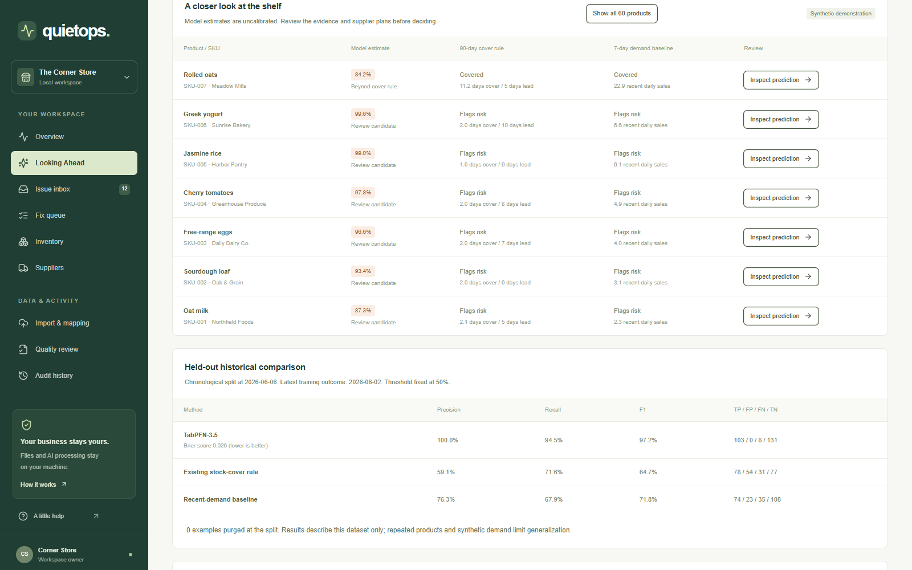
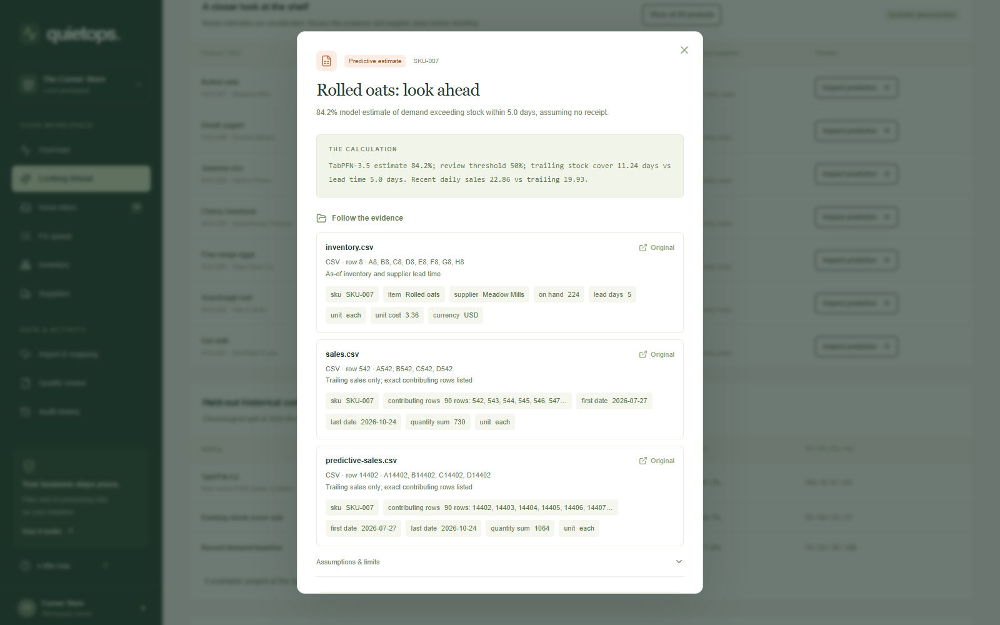
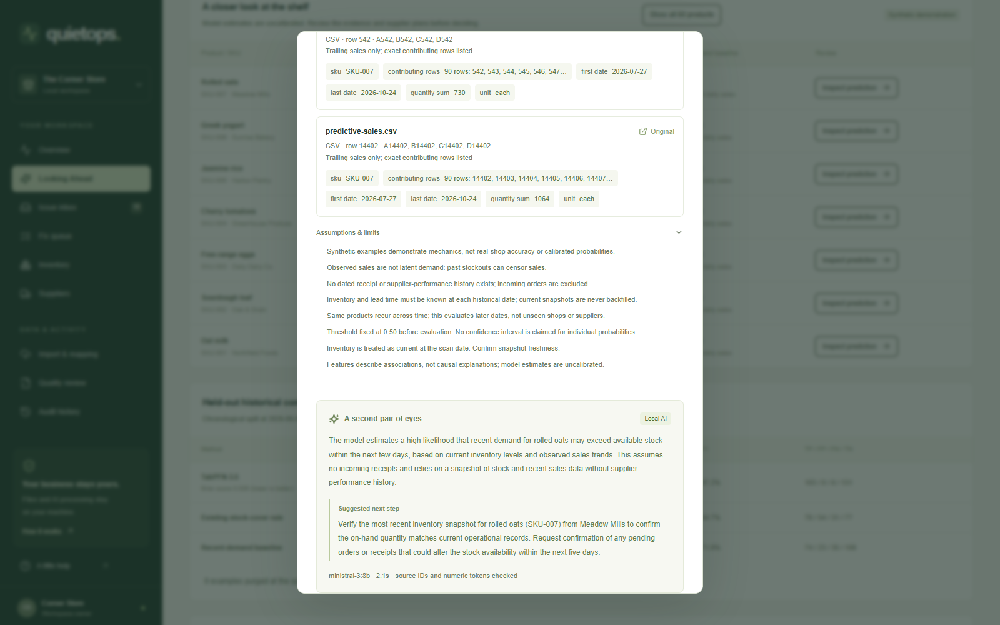
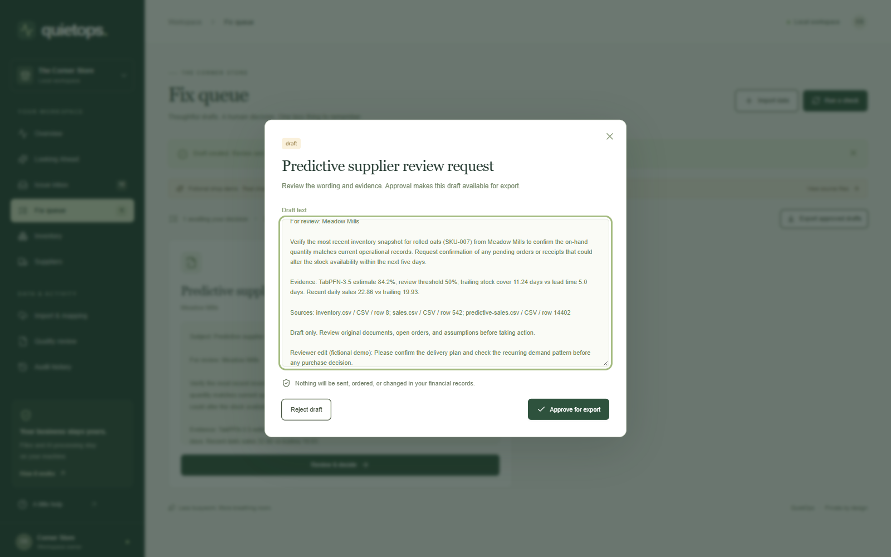

# Draft addendum: Looking Ahead with genuine TabPFN-3.5

**Best Use of TabPFN — local draft for review. Not published or added to the existing DEV post.**

QuietOps already checks a fictional shop's stock cover, deliveries and invoices, then uses local Ministral to explain source-linked findings. I added a separate **Looking Ahead** review inside that existing application.

The new question is predictive: **will sales during the supplier lead-time window exceed stock on hand, assuming no delivery arrives?** This is a demand-exceeds-stock estimate, not certainty that a real physical stockout will occur or that a supplier will fail.

Genuine local binary classification runs through `tabpfn==9.2.0`, explicitly selecting `ModelVersion.V3_5`. The official September 9 checkpoint is pinned to a Hugging Face revision and checked against its SHA-256. Each result records the checkpoint, package, PyTorch build, device, two estimators and seed 42. When inference fails, no other predictor supplies TabPFN-labelled scores.

## What the data supports

The original fixture has 90 days of sales but only one inventory snapshot. That cannot provide honest historical stockout labels. An optional **synthetic** companion adds dated stock snapshots and earlier sales while preserving original files. Each historical feature row uses only information available then; later compatible sales supply its label. Today's cumulative order receipt flags are excluded because their historical availability is unknown.

The chronological holdout uses **420 earlier training examples and 240 later test examples**. Training outcomes end by June 2; test snapshots begin June 6. The split excludes examples whose labels cross the boundary; this fixture's spaced dates required zero exclusions. All three methods receive the same held-out rows.

| Method | Precision | Recall | F1 | TP / FP / FN / TN |
| --- | ---: | ---: | ---: | --- |
| TabPFN-3.5 | 100.0% | 94.5% | 97.2% | 103 / 0 / 6 / 131 |
| Existing trailing stock-cover rule | 59.1% | 71.6% | 64.7% | 78 / 54 / 31 / 77 |
| Seven-day demand baseline | 76.3% | 67.9% | 71.8% | 74 / 23 / 35 / 108 |

TabPFN's Brier score was **0.0264**, ROC AUC **0.9900**, and average precision **0.9907**. It caught 30 positive held-out cases the cover rule missed. These are actual results from **one synthetic temporal holdout**, with repeated products and related demand patterns. They do not establish real-shop accuracy, calibrated risk, prevented losses or saved time. [Full outputs and input hashes](tabpfn-evaluation.json).

## A disagreement, with selection disclosed

The live fictional illustration continues recurring demand for SKU-007. It has **224 units**, **11.24 days** of trailing cover and a **five-day** supplier lead time. Recent seven-day cover also exceeds lead time. Both simple baselines show cover, while TabPFN estimates **84.2%** demand-exceeds-stock risk.

This current illustration was selected **after exploring model outputs**. The first isolated one-week surge was not flagged, and longer isolated plateaus were not flagged either. It is a constructed illustration, not an independent test. The separate held-out historical rows and reported metrics did not change during this selection. Synthetic recurrence may not hold in real shops.

## Prediction, explanation and approval

TabPFN supplies the probability. Local **Ministral 3 8B** explains supplied facts and drafts a supplier-review step. Source-ID and numeric checks reject unknown evidence and unsupported numbers. A predictive percentage check prevents reusing another evidence number as an altered probability. These are conservative guards, not a semantic proof; a person still reviews the wording.

Predictions remain outside the deterministic issue inbox. Source evidence and model configuration enter the draft fingerprint. Changed mappings or scan dates make predictive drafts stale. The existing Fix queue lets a person edit and approve a review request for manual export. Nothing is sent or purchased.

## Try the workflow

- [Model setup, access and license](TABPFN_SETUP.md)
- [Data audit and evaluation methodology](TABPFN_EVALUATION.md)
- [Captioned recording of the real workflow](../demo/assets/tabpfn/looking-ahead-demo.mp4)
- [Demo walkthrough](TABPFN_DEMO.md)
- [Adapter](../backend/tabpfn_adapter.py), [features and evaluation](../backend/predictive.py), [regression tests](../backend/tests/test_predictive.py)

Weights use Prior Labs' [non-commercial, non-production license](https://huggingface.co/Prior-Labs/tabpfn_3_5/blob/main/LICENSE), separate from this repository's license. The owner accepted it for this local hackathon demo; other users must accept terms themselves, and commercial deployment requires an appropriate license. No model weights or credentials are committed.

The existing published DEV article remains unchanged. Publication of this draft requires the owner's separate decision.
